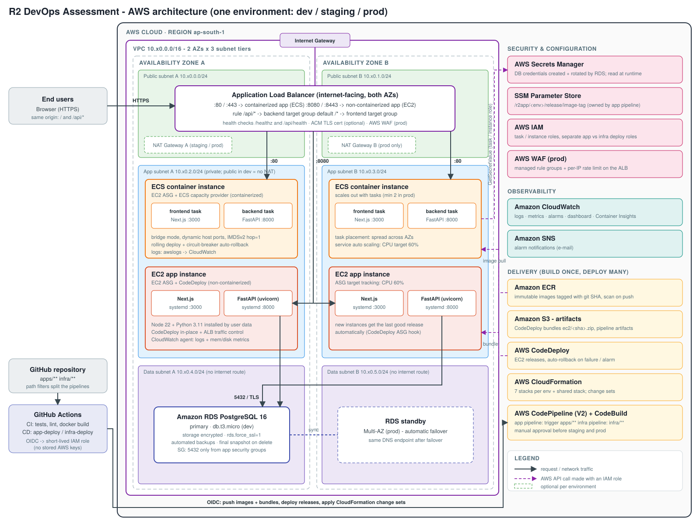

# R2 DevOps Assessment: Next.js + Python + PostgreSQL on AWS

A production-style AWS platform for one **Next.js** frontend, one **Python (FastAPI)** backend and a **PostgreSQL** database. It includes:

* **Two deployment approaches side by side:**
  * **containerized** on Amazon ECS, served on port 80
  * **non-containerized** on EC2 with AWS CodeDeploy, served on port 8080
* **Infrastructure as Code:** AWS CloudFormation, with one set of templates for **dev / staging / prod**
* **CI/CD:** GitHub Actions **and** AWS CodePipeline/CodeBuild/CodeDeploy
* **Separate pipelines** for application and infrastructure, enforced by triggers, scripts and IAM
* **Secrets:** stored in AWS Secrets Manager, created and rotated by RDS, and read at runtime with IAM roles
* **Monitoring:** CloudWatch alarms and a dashboard, with automatic and manual **rollback**



## Documentation

| Document | Contents |
|---|---|
| [docs/ARCHITECTURE.md](docs/ARCHITECTURE.md) | Architecture overview, why each AWS service is used, how everything connects, IaC approach, CI/CD workflow, security, monitoring, rollback strategy, cost and trade-offs |
| [docs/DEPLOYMENT.md](docs/DEPLOYMENT.md) | Step-by-step deployment for a fresh AWS account, day-2 operations, tear-down, troubleshooting |
| [docs/architecture.svg](docs/architecture.svg) | Architecture diagram (vector) |

## Repository layout

```
apps/
  frontend/                Next.js 16 (standalone output) + Dockerfile
  backend/                 FastAPI + psycopg 3 + tests + Dockerfile
deploy/codedeploy/         appspec.yml, lifecycle hook scripts, systemd units (EC2 approach)
infra/
  cloudformation/          shared, network, security, alb, database, monitoring, ecs, ec2, pipelines
  environments/            dev.json, staging.json, prod.json  (all per-environment differences)
scripts/                   bootstrap, build-and-push, deploy-infra, deploy-app, rollback-app, destroy ...
ci/                        CodeBuild buildspecs (AWS-native pipeline)
.github/workflows/         ci.yml, app-deploy.yml, app-rollback.yml, infra-deploy.yml
docker-compose.yml         local stack (nginx plays the ALB)
```

## Quick start

```bash
# local development
docker compose up --build                          # http://localhost:8080

# AWS (see docs/DEPLOYMENT.md for the full walkthrough)
export AWS_REGION=ap-south-1
bash scripts/bootstrap.sh <github-owner> <repo>    # once, admin credentials
bash scripts/first-deploy.sh dev                   # build → infra → release
bash scripts/destroy.sh dev                        # stop all charges when done
```

| Change you push | What runs | What it touches |
|---|---|---|
| `apps/**`, `deploy/codedeploy/**` | **App deploy** (GitHub) / `r2app-app` (CodePipeline) | ECR images, S3 bundle, ECS services, CodeDeploy, SSM release tag. **Never CloudFormation.** |
| `infra/**` | **Infra deploy** (GitHub) / `r2app-infra` (CodePipeline) | CloudFormation change sets only. **Never builds or ships app code.** |

## Checks run on every PR

`pytest` · `next build` + `tsc` · `docker build` · `cfn-lint` · `shellcheck`
