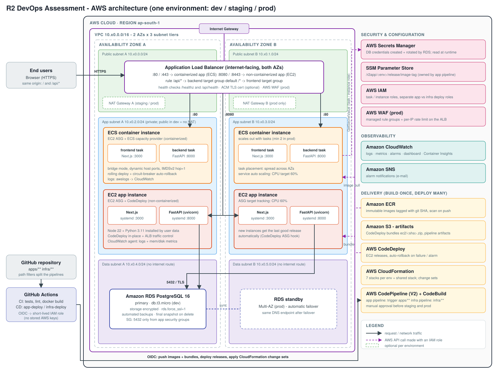
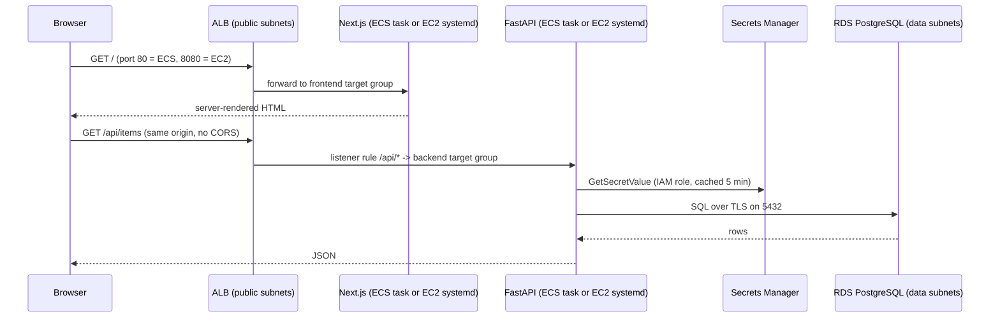
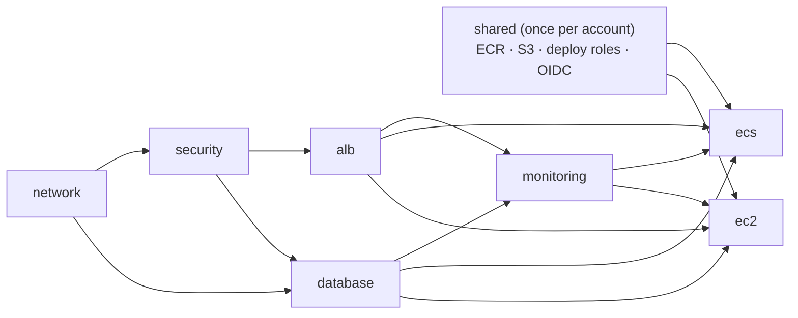
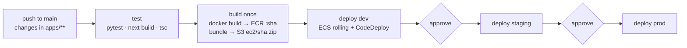
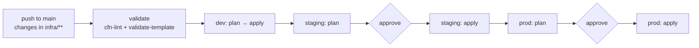

# Architecture & Design Document

**Project:** R2 DevOps Assessment: a Next.js frontend, a Python (FastAPI) backend and PostgreSQL on AWS
**IaC:** AWS CloudFormation · **CI/CD:** GitHub Actions and AWS CodePipeline/CodeBuild/CodeDeploy
**Deployment approaches:** containerized (Amazon ECS) and non-containerized (EC2 + CodeDeploy), running side by side



---

## 1. Summary

The system runs one Next.js web app, one Python REST API and one PostgreSQL database in **three isolated environments** (dev, staging, prod). All three use the same CloudFormation templates. Only the parameter files differ.

Both deployment approaches the assessment asks for run at the same time in each environment, behind one load balancer:

| Approach | Where it runs | How a release is shipped | URL |
|---|---|---|---|
| **Containerized** | Docker images on an **Amazon ECS** cluster (EC2 capacity) | New task-definition revision → ECS rolling update | `http://<alb-dns>` (port 80/443) |
| **Non-containerized** | Node.js and Python processes under **systemd** on an EC2 Auto Scaling group | **AWS CodeDeploy** in-place deployment | `http://<alb-dns>:8080` (port 8080/8443) |

Both approaches use the same database, the same build and the same release tag (the git commit SHA), so you can compare them directly.

Five design rules shape the rest of this document:

1. **Build once, deploy many.** Each commit is built one time into immutable artifacts. Those same artifacts are promoted from dev to staging to prod.
2. **Application and infrastructure are separate.** They have separate pipelines, triggers and IAM roles, and different owners of state (section 7).
3. **No secrets in code, pipelines or environment variables.** RDS creates and rotates the database password in Secrets Manager. The app reads it at runtime through its IAM role.
4. **Defense in depth.** There are three subnet tiers, a security-group chain, least-privilege IAM, IMDSv2, encryption at rest and TLS to the database.
5. **Everything is code and every change can be rolled back.** CloudFormation change sets, ECS circuit breakers, CodeDeploy auto-rollback and immutable release tags make this possible.

---

## 2. AWS services used and why

### Networking
| Service | Why it is used |
|---|---|
| **Amazon VPC** (1 per env, `/16`) | Isolates each environment's network. Its six `/24` subnets cover **2 Availability Zones × 3 tiers** (public, app, data). Running in two AZs is what makes the system highly available. |
| **Internet Gateway** | Gives the public subnets (the ALB, and app instances in dev) a path to the internet. |
| **NAT Gateway** (optional) | Gives private app instances outbound internet access (to ECR, package repositories and AWS APIs). `NatGatewayMode`: `none` in dev to stay free, `single` in staging, `per-az` in prod so that losing one AZ does not cut egress for the other. |
| **S3 Gateway VPC endpoint** | Free. S3 traffic (CodeDeploy bundles, ECR image layers) stays on the AWS network and avoids NAT data charges. |
| **Application Load Balancer** | The single entry point. It does path-based routing (`/api/*` to the backend, everything else to the frontend), checks target health and terminates TLS. One ALB serves both deployment approaches on different listener ports, which saves cost. |
| **VPC Flow Logs** (staging/prod) | Records rejected traffic for security investigations. |

### Compute
| Service | Why it is used |
|---|---|
| **Amazon ECS on EC2** (containerized) | A managed container orchestrator. EC2 capacity was chosen over Fargate because Fargate is not free-tier eligible, while `t3.micro` instances are. A **capacity provider with managed scaling** adds or removes hosts automatically so tasks always have room. Switching to Fargate in production is a template change, not a redesign. |
| **EC2 Auto Scaling + AWS CodeDeploy** (non-containerized) | The classic VM deployment model. The instance image holds only the runtimes (Node 22, Python 3.11, the CodeDeploy agent and the CloudWatch agent). CodeDeploy delivers the application, so a release never needs a new AMI or a CloudFormation update. |
| **Amazon ECR** | A private image registry with **immutable tags** (a git SHA can never be overwritten), vulnerability scanning on push and a lifecycle policy that keeps the last 30 images. |

### Database
| Service | Why it is used |
|---|---|
| **Amazon RDS for PostgreSQL 16** | A managed database with backups, patching, encryption and Multi-AZ failover. `db.t3.micro` single-AZ in dev (free-tier eligible). **Multi-AZ** with storage autoscaling and deletion protection in prod. |

### Security
| Service | Why it is used |
|---|---|
| **AWS Secrets Manager** | Stores the database credentials. RDS creates the secret itself (`ManageMasterUserPassword`) and **rotates it automatically**, so no person or template ever handles the password. |
| **SSM Parameter Store** | Stores the **currently released image tag** for each environment (`/r2app/<env>/release/image-tag`). This is how the app pipeline and the infra pipeline share state safely (section 7). |
| **AWS IAM** | Gives every workload its own least-privilege role: ECS task role, ECS execution role, EC2 instance role and CodeDeploy service role. **Separate deploy roles for app and infra.** GitHub authenticates with **OIDC** (no stored AWS keys). |
| **AWS WAF** (prod) | Adds AWS managed rule groups (common exploits, known bad inputs) and a per-IP rate limit in front of the ALB. |
| **AWS Certificate Manager** (optional) | Supplies the TLS certificate. When `CertificateArn` is set, HTTPS listeners are created and HTTP is redirected to HTTPS. |

### Monitoring
| Service | Why it is used |
|---|---|
| **Amazon CloudWatch** | Collects logs (ECS `awslogs`, and the CloudWatch agent on EC2 for app, CodeDeploy and memory/disk), metrics, **alarms** and one **dashboard** per environment. Container Insights is enabled in staging and prod. |
| **Amazon SNS** | Sends alarm notifications by e-mail. |

### CI/CD
| Service | Why it is used |
|---|---|
| **GitHub Actions** | Runs pull-request CI (tests, type checks, Docker build, cfn-lint, shellcheck) and offers a full CD path (app and infra workflows with environment approvals). |
| **AWS CodePipeline (V2) + CodeBuild** | The AWS-native CD path. **File-path trigger filters** start the app pipeline only for `apps/**` and the infra pipeline only for `infra/**`. Manual approval actions gate staging and prod. |
| **AWS CodeDeploy** | Ships releases to the EC2 fleet with ALB traffic control and automatic rollback. |
| **AWS CloudFormation** | Defines all infrastructure. Every update goes through a **change set**. |

---

## 3. How the pieces connect

### 3.1 Request flow (what happens when a user opens the site)



* The browser always calls **relative** URLs (`/api/...`), so the frontend has no backend address built into it. The **ALB listener rule** (`path-pattern /api/*`, priority 10) routes those calls to the backend. This is why the backend serves every route under `/api` and the frontend health check is `/healthz`.
* The ALB's **target groups** know where each app runs:
  * ECS (bridge network mode) registers each container's **dynamic host port** with the target group automatically.
  * The EC2 Auto Scaling group registers every instance on ports **3000** and **8000**.
* `/api/health` deliberately **does not touch the database**. If the database had a blip and the health check depended on it, the ALB would mark every app target unhealthy at once. `/api/ready` is the deep check that does include the database.

### 3.2 Network chain of trust (security groups)

```
Internet ──80/443/8080/8443──► ALB-SG
ALB-SG   ──32768-65535───────► ECS-Host-SG      (dynamic container ports)
ALB-SG   ──3000, 8000────────► EC2-App-SG
ECS-Host-SG, EC2-App-SG ─5432► DB-SG            (DB-SG has no egress at all)
```

Each tier accepts traffic **only from the security group of the tier in front of it**, not from IP ranges. So even in dev, where the app instances sit in public subnets with public IPs (no NAT), nothing on the internet can reach them directly. **No SSH port is open anywhere.** Shell access goes through **SSM Session Manager**, which is audited in CloudTrail.

Subnet tiers:
* **Public:** the ALB, NAT gateways, and the app instances in dev only.
* **App (private):** ECS hosts and EC2 app instances. Outbound traffic goes through NAT.
* **Data (isolated):** RDS. Its route table has **no route to the internet at all**.

### 3.3 How the application gets its configuration and secrets

| Kind of value | Source | How it reaches the app |
|---|---|---|
| Non-secret config (`DB_HOST`, `DB_NAME`, `APP_ENV`, …) | CloudFormation exports from the database stack | ECS: task-definition `environment` block. EC2: `/etc/r2app/app.env`, written by user data and loaded by systemd `EnvironmentFile`. |
| Database credentials | Secrets Manager (created and rotated by RDS) | Only the **ARN** is passed in. The backend calls `GetSecretValue` with its IAM role, caches the value for 5 minutes, and on an authentication failure **re-fetches once**. Password rotation is therefore transparent. |
| Release version | Build argument / `version.env` | Baked into the image or bundle, so `/api/info` always reports what is really running. |
| Released image tag (per env) | SSM Parameter Store | Read by the ECS CloudFormation stack (parameter type `AWS::SSM::Parameter::Value<String>`). Written by the app pipeline. |

Why the password is not injected with ECS `secrets`: values injected at container start go stale when RDS rotates the password, and they show up in the process environment. Reading at runtime avoids both problems, and ECS and EC2 use the same code path.

### 3.4 How the CloudFormation stacks connect

The infrastructure is split into **small stacks with clear owners**, linked by **CloudFormation exports and `Fn::ImportValue`**:



| Stack | Main contents | Exports used by others |
|---|---|---|
| `r2app-shared` | ECR repos, artifact bucket, CloudFormation execution role, `app-deploy` / `infra-deploy` managed policies, GitHub OIDC roles | repository URIs, bucket, policy ARNs |
| `r2app-<env>-network` | VPC, 6 subnets, IGW, NAT, route tables, S3 endpoint, flow logs | VPC id, subnet lists (`ComputeSubnetIds` switches between private and public depending on NAT mode) |
| `r2app-<env>-security` | 4 security groups | SG ids |
| `r2app-<env>-alb` | ALB, optional WAF | ALB ARN, DNS name, full name (for metrics) |
| `r2app-<env>-database` | RDS, subnet group, parameter group (`rds.force_ssl=1`) | endpoint, port, db name, **secret ARN** |
| `r2app-<env>-monitoring` | SNS topic, ALB/RDS alarms, dashboard | alert topic ARN |
| `r2app-<env>-ecs` | Cluster, launch template, ASG, capacity provider, task definitions, services, target groups, listener :80/:443, autoscaling, alarms | none |
| `r2app-<env>-ec2` | Launch template (runtimes only), ASG, target groups, listener :8080/:8443, CodeDeploy app and deployment group, alarms | none |
| `r2app-pipelines` | CodeStar connection, CodeBuild projects, app and infra CodePipelines | none |

Why separate stacks rather than one big stack or nested stacks:
* **Blast radius:** a change to ECS cannot accidentally replace the database.
* **Different lifecycles:** the network and database change rarely, compute changes more often.
* **Choice:** you can deploy only `ecs` or only `ec2`. The deploy scripts detect which compute stacks exist.

---

## 4. Deployment approaches in detail

### 4.1 Containerized: Amazon ECS

* **Images:** multi-stage Dockerfiles. Python runs on `python:3.12-slim` with a virtualenv. Next.js uses `output: "standalone"` on `node:22-alpine`. Both run as a **non-root user** and are pulled from the ECR Public mirror to avoid Docker Hub rate limits.
* **Cluster capacity:** a launch template using the ECS-optimized AL2023 AMI (resolved from SSM, so it is always the latest), IMDSv2 with **hop limit 1** (containers in bridge mode cannot reach the instance metadata service, so they must use their **task role** rather than the host's role), and an encrypted gp3 root volume.
* **Services:** frontend and backend each have their own service and task definition. Settings:
  * `MinimumHealthyPercent 100 / MaximumPercent 200`: start new tasks before stopping old ones.
  * **Deployment circuit breaker with rollback**: if new tasks keep failing health checks, ECS restores the previous revision automatically.
  * Placement **spread across AZs**, then binpack on memory.
  * **Target-tracking auto scaling** on CPU (60%). The capacity provider then adds hosts when tasks need them.
* **Releasing:** `scripts/deploy-app.sh` copies the live task definition, swaps in the new image, registers a new revision, calls `update-service` and watches the rollout. A circuit-breaker rollback is reported as a **failed** pipeline run.

### 4.2 Non-containerized: EC2 + CodeDeploy

* **Instance bootstrap (user data):** installs Python 3.11, Node.js 22 LTS (downloaded from nodejs.org and **checked against the published SHA-256 list**), the CloudWatch agent and the CodeDeploy agent. It also writes `/etc/r2app/app.env`. When done it sends a **`cfn-signal`**: the stack's `CreationPolicy` waits for this, so the first release never races an instance that is still installing.
* **Bundle (`dist/ec2-bundle-<sha>.zip`):** built in CI. It contains the **pre-built** Next.js standalone server (so there is no `npm` or build step on a 1 GB instance), the Python source, `appspec.yml`, the hook scripts and the systemd unit files.
* **CodeDeploy lifecycle:**
  1. `ApplicationStop` stops the old services.
  2. `BeforeInstall` cleans the release directory.
  3. `AfterInstall` creates a virtualenv, runs `pip install` and installs the systemd units.
  4. `ApplicationStart` restarts the services.
  5. `ValidateService` curls `/api/health` and `/healthz` and **fails the deployment if either is down**.
* **Traffic control:** `WITH_TRAFFIC_CONTROL` takes each instance out of both target groups while it is being updated. The deployment config is `AllAtOnce` in dev, `HalfAtATime` in staging and `OneAtATime` in prod (zero downtime with at least 2 instances).
* **Self-healing:** the deployment group is attached to the ASG, so any instance launched later (scale-out or replacement) gets the **last successful revision** automatically.
* **Processes:** the systemd units run as an unprivileged `r2app` user with `NoNewPrivileges` and `ProtectSystem`, restart automatically, and log to files that the CloudWatch agent ships.

---

## 5. Infrastructure as Code approach

* **CloudFormation YAML** in `infra/cloudformation/`, validated by **cfn-lint** in every PR and in the infra pipeline.
* **Reusable templates:** every template takes `ProjectName` and `EnvironmentName`. Resource names and exports are built from them (`${ProjectName}-${EnvironmentName}-...`), so the same template serves any number of environments.
* **Environment management:** `infra/environments/{dev,staging,prod}.json` holds **one section per stack**. `scripts/deploy-infra.sh` turns a section into parameter overrides. Environments differ **only in configuration**:

| Setting | dev | staging | prod |
|---|---|---|---|
| VPC CIDR | 10.10.0.0/16 | 10.20.0.0/16 | 10.30.0.0/16 |
| NAT | none (free) | single | one per AZ |
| RDS | t3.micro, single-AZ, 1-day backups | t3.micro, 3-day backups, storage autoscaling | t3.small, **Multi-AZ**, 7-day backups, deletion protection |
| ECS hosts / tasks | 1–2 / 1–2 | 1–3 / 2–4 | 2–6 / 2–8 |
| EC2 instances | 1–2 | 1–3 | 2–6 |
| CodeDeploy config | AllAtOnce | HalfAtATime | OneAtATime |
| WAF / ALB deletion protection | off | off | **on** |
| Flow logs / Container Insights | off | on | on |

* **Change sets everywhere:** `deploy-infra.sh <env> plan` creates a change set for every existing stack, prints the resource actions (including **Replacement: True** warnings), writes them to the GitHub job summary, then deletes the change set. `apply` deploys in dependency order with `aws cloudformation deploy`, which also uses change sets internally.
* **Least privilege for IaC:** pipelines never create resources directly. They can only call CloudFormation and pass the dedicated **`r2app-cfn-execution-role`**, which only the CloudFormation service can assume.
* **Stateful resources are protected:** RDS has `DeletionPolicy: Snapshot` and `UpdateReplacePolicy: Snapshot`, plus deletion protection in prod. The artifacts bucket has `DeletionPolicy: Retain`.

---

## 6. CI/CD workflow

Two CD implementations are provided. They use the **same scripts**, so they cannot behave differently:

| Step | GitHub Actions | AWS-native |
|---|---|---|
| PR checks | `ci.yml` (pytest, Next.js build and type check, Docker build, cfn-lint, shellcheck) | n/a |
| App build | `app-deploy.yml` job `build` → `scripts/build-and-push.sh` | CodePipeline `r2app-app` → CodeBuild `buildspec-app-build.yml` → same script |
| App deploy dev→staging→prod | jobs with GitHub **Environments** (required reviewers on staging and prod) → `scripts/deploy-app.sh` | CodeBuild `buildspec-app-deploy.yml` per stage, **manual approval** actions between stages |
| Infra | `infra-deploy.yml`: validate → dev plan+apply → staging plan → *approval* → apply → prod plan → *approval* → apply | CodePipeline `r2app-infra`: validate → dev → *approval* → staging → *approval* → prod |
| Rollback | `app-rollback.yml` (manual, choose env + tag) | re-run an old pipeline execution, or run `scripts/rollback-app.sh` |

The repository variable **`CD_PROVIDER`** (`github` or `aws`) chooses which system deploys, so a push never deploys twice. **`ENABLED_ENVIRONMENTS`** (default `dev`) keeps the GitHub workflows from creating paid staging and prod environments by accident.

### 6.1 Application pipeline



1. **Test:** backend unit tests (the database is replaced by a fake repository), then the Next.js production build and TypeScript check.
2. **Build once:** images are tagged with the **commit SHA** and pushed to ECR (immutable). The CodeDeploy bundle goes to S3. If the artifacts already exist they are reused, so both CI systems can run safely.
3. **Deploy (per environment):** `deploy-app.sh <env> <sha>`:
   * checks the artifacts exist
   * rolls out ECS (backend first, then frontend) and waits; a circuit-breaker rollback fails the job
   * runs a CodeDeploy deployment to the EC2 fleet and waits; a failure triggers CodeDeploy's automatic rollback
   * only after both succeed, writes `image-tag` (and `previous-image-tag`) to SSM.

### 6.2 Infrastructure pipeline



---

## 7. How application and infrastructure changes are kept apart

This is requirement #4. It is enforced at **four independent layers**:

1. **Triggers.** GitHub `paths:` filters and CodePipeline V2 **file-path trigger filters**: `apps/**` and `deploy/codedeploy/**` start only the app pipeline, and `infra/**` starts only the infra pipeline.
2. **Code paths.** `deploy-app.sh` never calls CloudFormation. `deploy-infra.sh` never builds or ships code.
3. **IAM.** The app deploy role (`r2app-app-deploy` policy) has **no CloudFormation write permission and cannot pass the execution role**. So an application deployment *cannot* change infrastructure, even by mistake or through a compromised workflow. The infra role cannot push images or create CodeDeploy deployments.
4. **State ownership.** This prevents the classic "infra deploy rolls back the app" problem. If the image tag were an ordinary CloudFormation parameter, every release would need a stack update, and every infra update would put back whatever tag the template had last seen. Instead:
   * the **app pipeline owns** `/r2app/<env>/release/image-tag` in SSM and updates ECS directly
   * the ECS stack **reads** that SSM parameter at deploy time (`AWS::SSM::Parameter::Value<String>`)
   * so an infrastructure deployment always re-renders the task definition with **the release that is live right now**.

   On EC2 the problem never comes up: the launch template contains runtimes only, and CodeDeploy owns the application files.

The first time an environment is created, `deploy-infra.sh` seeds the SSM parameter with the newest image present in ECR, so the ECS services can start.

---

## 8. Security approach

| Area | Control |
|---|---|
| **Secret storage** | The RDS master password is generated by RDS, stored in **Secrets Manager** (encrypted with KMS) and rotated automatically. No secret appears in Git, templates, parameters, pipeline variables, user data or container environments. GitHub holds **no secrets at all**: only role ARNs, as plain variables. |
| **Access to secrets** | Only the backend task role and the EC2 app role can call `secretsmanager:GetSecretValue`, and only on that one secret ARN. The task role trust policy includes an `aws:SourceArn` condition. |
| **CI/CD identity** | GitHub OIDC with short-lived credentials (1 hour). The trust policy allows only `repo:<owner>/<repo>` on `refs/heads/main` or a GitHub Environment. Separate app and infra roles. CloudFormation uses its own execution role. |
| **Network** | Three subnet tiers. Security-group chaining. The database has no internet route and no egress. No SSH; SSM Session Manager instead. Optional WAF. Ingress CIDR is configurable. |
| **Encryption** | RDS storage encrypted. **TLS enforced to PostgreSQL** (`rds.force_ssl=1`, client `sslmode=require`). EBS volumes encrypted. S3 encrypted with a **TLS-only bucket policy** and all public access blocked. ECR encrypted. HTTPS on the ALB with a TLS 1.3 policy when a certificate is supplied. |
| **Workload hardening** | Non-root containers and systemd users. IMDSv2 required (hop limit 1). `NoNewPrivileges` and `ProtectSystem`. The ALB drops invalid header fields. |
| **Supply chain** | Immutable ECR tags plus **scan on push**. Pinned dependency versions (`requirements.txt`, `package-lock.json`). The Node.js binary is checksum-verified. |
| **Audit** | CloudTrail records every API call, including SSM sessions and secret reads. Flow logs are on in staging and prod. |

---

## 9. Monitoring and alerting

* **Logs:** `/r2app/<env>/ecs/{frontend,backend}` and `/r2app/<env>/ec2/{frontend,backend,codedeploy-agent}`, retained 7, 14 or 30 days depending on the environment. RDS PostgreSQL logs are exported to CloudWatch, and queries slower than 1 second are logged.
* **Alarms → SNS:**
  * ALB 5xx
  * ALB p95 latency
  * RDS CPU and free storage
  * unhealthy hosts in each target group
  * EC2 backend 5xx (also used by CodeDeploy as a **rollback trigger**)
* **Dashboard:** `r2app-<env>` shows ALB traffic, errors and latency, ECS service CPU and memory, EC2 ASG CPU, and RDS CPU, connections, storage and memory.
* **Health endpoints:** `/healthz` (frontend), `/api/health` (backend liveness), `/api/ready` (backend and database), and `/api/info` (version, deployment target, database status, shown on the home page).

---

## 10. Rollback strategy

| Failure | What happens automatically | What you can do manually |
|---|---|---|
| New ECS tasks fail health checks | The **deployment circuit breaker** stops the rollout and restores the last working task definition. The pipeline fails. | n/a |
| A CodeDeploy hook or `ValidateService` fails | **CodeDeploy auto-rollback** redeploys the last successful revision. | n/a |
| Backend 5xx spike during an EC2 deployment | The CloudWatch alarm stops the deployment and **rolls it back**. | n/a |
| A bad release reached an environment (bug found later) | n/a | `App rollback` workflow, or `scripts/rollback-app.sh <env> [sha]`. With no SHA it uses `previous-image-tag` from SSM. Any older SHA works because images and bundles are **immutable and kept** (last 30 images; bundles for 180 days). |
| Infrastructure change fails | CloudFormation **rolls the stack back** to its last stable state. | n/a |
| Infrastructure change succeeded but is wrong | n/a | `git revert` the template or parameter change, which the infra pipeline then applies. **Review change sets before approving.** |
| Data problem | n/a | RDS point-in-time restore within the backup window. Final snapshot on deletion. Multi-AZ failover in prod. |

---

## 11. High availability and scalability

* **Multi-AZ by design:** the ALB, both Auto Scaling groups and the ECS task placement span two AZs. RDS is Multi-AZ in prod. NAT is per AZ in prod.
* **Horizontal scaling:**
  * ECS service auto scaling (CPU 60%) combined with capacity-provider managed scaling of hosts
  * EC2 ASG target tracking (CPU 60%)
  * RDS storage autoscaling
* **Stateless app tier:** no sessions on disk, so any instance or task can serve any request.
* **Zero-downtime releases:** ECS rolling 100/200. CodeDeploy `OneAtATime` with ALB deregistration in prod.

---

## 12. Cost and free-tier notes

* **dev** is designed for a free-tier or credit account: no NAT gateway, `t3.micro` and `db.t3.micro`, single-AZ, no WAF, no Container Insights, short log retention. You can also deploy **only one** compute stack.
* Things that still cost money: running two `t3.micro` instances at the same time (ECS host and EC2 app instance) can go beyond a 750-hour allowance; public IPv4 addresses; the Secrets Manager secret (about USD 0.40 per month); data transfer.
* **staging/prod** add NAT gateways, Multi-AZ RDS, WAF and larger instances. These are real costs, so they are disabled by default (`ENABLED_ENVIRONMENTS=dev`).
* AWS accounts created **after 15 July 2025** use a credit-based Free plan, which also blocks some services. If a stack fails because of an account-plan restriction, upgrade the account to the Paid plan (remaining credits still apply).
* **Always run `scripts/destroy.sh dev` when you finish a demo.**

---

## 13. Trade-offs and next steps for a real production system

* **Fargate** instead of EC2 capacity (no host patching), or Graviton (`t4g`) instances for better price per performance.
* **Blue/green** for ECS with CodeDeploy (canary or linear traffic shifting) instead of rolling updates.
* **Multi-account** setup (AWS Organizations: separate dev, staging and prod accounts) instead of separation by VPC and stack name prefix.
* A dedicated **least-privilege database user** for the app, created by a migration job, instead of the RDS master user. **Alembic** migrations run as a pipeline step.
* A customer-managed **KMS key** for Secrets Manager, SNS and logs. A **Route 53** domain with ACM and HTTPS everywhere.
* **ECR image signing** and an admission policy. Dependency scanning (Dependabot or Inspector).
* RDS Proxy for connection pooling. ElastiCache if caching is needed.
